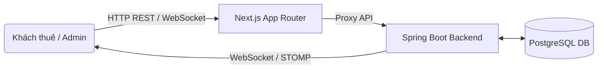

<div align="center">
  

  # 🏡 EasyHouse - Hệ Thống Quản Lý Phòng Trọ & Căn Hộ Dịch Vụ
  
  *Một giải pháp quản lý nhà trọ hiện đại, tự động, theo thời gian thực.*
</div>

---

## 1. 📖 Giới thiệu dự án

**EasyHouse** (Hệ thống quản lý phòng trọ / Boarding House Management System) là một ứng dụng nền nền tảng web được phát triển để giải quyết các bài toán đau đầu trong việc vận hành và quản lý nhà trọ, căn hộ dịch vụ tại Việt Nam.

**Mục đích & Vấn đề giải quyết:**
- Chấm dứt việc quản lý thủ công qua sổ sách, Excel hay Zalo rải rác.
- Tự động hóa quá trình tính toán tiền điện, nước, dịch vụ và xuất hóa đơn.
- Minh bạch hóa thông tin giữa chủ nhà (Admin) và khách thuê (Tenant).
- Quản lý sự cố, hợp đồng và công nợ một cách trơn tru, không bỏ sót.

**Đối tượng sử dụng:**
1. **Chủ trọ / Ban quản lý (Admin):** Cần công cụ quản trị tập trung nhiều tòa nhà, hàng trăm phòng, quản lý thu chi, tài sản, hợp đồng.
2. **Khách thuê (Tenant):** Cần theo dõi minh bạch hóa đơn, hợp đồng, báo cáo sự cố hư hỏng, nhận thông báo kịp thời.

---

## 2. 🌟 Demo & Chức năng nổi bật

### Mô tả UI chính
- **Dashboard Admin:** Hiển thị biểu đồ doanh thu, tỷ lệ lấp đầy, số lượng phòng trống, các sự cố đang chờ xử lý và các hợp đồng sắp hết hạn. Thiết kế theo phong cách hiện đại với Sidebar điều hướng, bảng dữ liệu (Data Table) có phân trang và bộ lọc linh hoạt.
- **Tenant Portal:** Giao diện tối giản dành cho khách thuê. Tập trung vào các thẻ (Cards) hiển thị hóa đơn chưa thanh toán, trạng thái phòng, chuông thông báo Real-time và nút "Báo cáo sự cố".

### Các chức năng nổi bật
- ⚡ **Giao tiếp Real-time:** Tích hợp WebSocket (STOMP) cho tính năng **Chat trực tiếp** giữa Admin - Khách thuê và hệ thống **Thông báo đẩy** theo thời gian thực (Push Notifications).
- 💰 **Quản lý Tài chính Tự động:** Khai báo chỉ số điện/nước đầu cuối, hệ thống tự động nhân với cấu hình giá và tạo hóa đơn. Theo dõi công nợ chi tiết.
- 📝 **Hợp đồng Số & Đặt cọc:** Lưu trữ thông tin hợp đồng chặt chẽ, chu kỳ thanh toán, tiền cọc.
- 🔧 **Ticketing Sự cố:** Khách báo hỏng hóc, Admin tiếp nhận, đổi trạng thái (Đang xử lý -> Hoàn thành) rõ ràng.

---

## 3. 🏗️ Kiến trúc hệ thống

Dự án áp dụng kiến trúc **Client-Server** truyền thống nhưng được hiện đại hóa với việc phân tách Backend (RESTful API) và Frontend (SSR/CSR). 

- **Frontend (Client):** Xử lý giao diện người dùng, gọi API thông qua Next.js Server Components và Client Components. Có cơ chế Proxy API để tránh lỗi CORS và giấu endpoint thật.
- **Backend (API Server):** Đảm nhiệm Logic nghiệp vụ, bảo mật (JWT), truy xuất DB và xử lý WebSocket.
- **Database:** PostgreSQL dùng chung cho toàn bộ dữ liệu nghiệp vụ có quan hệ (Relational).

**Sơ đồ luồng cơ bản (Flow):**


---

## 4. 🛠️ Công nghệ sử dụng

### Frontend
- **Framework:** [Next.js 15](https://nextjs.org/) (App Router) & React 19
- **Ngôn ngữ:** TypeScript
- **Styling & UI:** Tailwind CSS v4, Radix UI (shadcn/ui), Lucide Icons
- **State Management:** Zustand, SWR / Fetch API
- **Auth & Real-time:** NextAuth.js v4, `@stomp/stompjs` (WebSocket)

### Backend
- **Framework:** [Spring Boot 3.x](https://spring.io/projects/spring-boot) (Java 21)
- **Data Access:** Spring Data JPA, Hibernate, PostgreSQL Driver
- **Security:** Spring Security, JWT Auth
- **Real-time:** Spring WebSocket & STOMP Broker
- **Khác:** Lombok, MapStruct, Cloudinary SDK (Lưu trữ ảnh gốc), Spring Mail

### Database & DevOps
- **Database:** PostgreSQL (Relational)
- **Cache (Optional):** Redis
- **DevOps:** Docker, Docker Compose
- **Monitoring:** Prometheus, Grafana, k6 (tích hợp trong thư mục `/monitoring`)

---

## 5. 📂 Cấu trúc thư mục

```text
easyhouse/
├── be/                       # ⚙️ MÃ NGUỒN BACKEND (Spring Boot)
│   ├── src/main/java/.../    # Logic code (Controllers, Services, Repositories, Entities)
│   └── src/main/resources/   # File config (application.properties, templates)
├── frontend/                 # 🎨 MÃ NGUỒN FRONTEND (Next.js)
│   ├── src/app/              # App Router (Pages, Layouts, API Routes)
│   ├── src/components/       # UI Components tái sử dụng (shadcn/ui, custom)
│   ├── src/lib/              # Utils, Cấu hình WebSocket, Auth
│   └── src/types/            # Định nghĩa TypeScript Interfaces
├── sql/                      # 🗄️ DATABASE
│   └── backup.sql            # File dump CSDL (Bao gồm cả Schema & Data mẫu)
├── monitoring/               # 📊 GIÁM SÁT HIỆU NĂNG
│   └── docker-compose.yml    # Prometheus, Grafana stack
└── docker-compose.easyhouse.yml # Cấu hình chạy toàn bộ dự án bằng Docker
```

---

## 6. 🚀 Hướng dẫn cài đặt

Bạn có thể chạy dự án thông qua Docker (Khuyên dùng) hoặc chạy thủ công từng dịch vụ.

### Bước 1: Clone project
```bash
git clone https://github.com/TranVy1/easyhouse.git
cd easyhouse
```

### Bước 2: Khôi phục Database
- Yêu cầu cài đặt PostgreSQL (nếu chạy local).
- Tạo Database tên `quanlyphongtro`.
- Dùng DBeaver, pgAdmin hoặc CLI để khôi phục file `sql/backup.sql` vào database vừa tạo. (Lưu ý: File này chứa cả cấu trúc bảng và dữ liệu mẫu của Admin).

### Bước 3: Cấu hình biến môi trường
Tạo các file biến môi trường tương ứng (xem chi tiết ở mục 7).

### Chạy bằng Docker (Khuyên dùng)
Dự án đã đóng gói sẵn mọi thứ trong `docker-compose.easyhouse.yml`.
```bash
docker compose -f docker-compose.easyhouse.yml up -d --build
```

### Chạy thủ công (Local)
**Chạy Backend:**
```bash
cd be
mvn clean install -DskipTests
mvn spring-boot:run
```

**Chạy Frontend:**
```bash
cd frontend
npm install
npm run dev
```

---

## 7. 🔐 Biến môi trường (.env)

### Frontend (Tạo file `frontend/.env.local`)
| Biến | Mô tả | Mặc định |
|---|---|---|
| `NEXT_PUBLIC_WS_URL` | URL kết nối WebSocket (STOMP) | `ws://localhost:8080/ws` |
| `BACKEND_URL` | URL API của Spring Boot | `http://localhost:8080` |
| `NEXTAUTH_SECRET` | Khóa bí mật mã hóa JWT của NextAuth | `secret-key-qlyphongtro` |
| `NEXTAUTH_URL` | URL gốc của Next.js | `http://localhost:3000` |
| `GEMINI_API_KEY` | (Optional) Key dùng cho Chatbot AI | `(Trống)` |

### Backend (Sửa file `be/src/main/resources/application.properties`)
Mặc định dự án có thể chạy ngay với `application.properties`, tuy nhiên bạn có thể override qua ENV variables:
| Biến (Properties / Env) | Mô tả | Mặc định |
|---|---|---|
| `spring.datasource.*` | Thông tin kết nối PostgreSQL | `jdbc:postgresql://localhost:5432/quanlyphongtro` |
| `jwt.access-ttl-minutes` | Thời gian sống của JWT Access Token | `600` (10 tiếng) |
| `PUSH_VAPID_PUBLIC_KEY` | Key cho WebPush (Notification) | `(Trống)` |

---

## 8. 📱 Hướng dẫn sử dụng

Truy cập hệ thống tại: **http://localhost:3000**

**Login Admin:**
- **Email:** `admin@easyhouse.local`
- **Mật khẩu:** `Admin@123`

**Luồng công việc cơ bản cho Admin:**
1. **Tạo Tòa nhà:** Bấm vào "Tòa nhà" -> Thêm mới.
2. **Tạo Phòng:** Vào chi tiết tòa nhà -> Thêm phòng, chỉ định diện tích, giá thuê gốc.
3. **Thêm Khách thuê:** Vào "Khách thuê" -> Điền thông tin.
4. **Lập Hợp đồng:** Chọn phòng -> Lập hợp đồng -> Gán khách thuê vào phòng.
5. **Chốt điện nước & Ra hóa đơn:** Mỗi tháng vào "Chỉ số điện nước" chốt số -> Sang "Hóa đơn" tạo hóa đơn mới, hệ thống tự lấy giá dịch vụ và điện nước tính tổng.

---

## 9. 🔌 API (Ví dụ Backend Endpoint)

Các Endpoint của Spring Boot đều bắt đầu bằng `/api/` và yêu cầu header `Authorization: Bearer <token>`. Trên Frontend, gọi trực tiếp `/api/...` (Next.js sẽ proxy sang backend).

**Ví dụ lấy danh sách Thông báo (GET `/api/thong-bao`)**
- **Response mẫu:**
```json
{
  "success": true,
  "message": "Thành công",
  "data": {
    "data": [
      {
        "id": "uuid-1234",
        "tieuDe": "Nhắc nhở đóng tiền nhà tháng 7",
        "noiDung": "Các bạn vui lòng đóng tiền...",
        "ngayTao": "2026-07-22T20:55:00",
        "guiTatCa": true
      }
    ],
    "currentPage": 1,
    "totalPages": 5,
    "totalItems": 45
  }
}
```

---

## 10. 🗄️ Database Schema

Hệ thống sử dụng cơ sở dữ liệu có quan hệ (RDBMS) rất chặt chẽ. Dưới đây là các thực thể (Tables) chính:

- `nguoi_dung`: Bảng User dùng chung để Login, phân quyền (ADMIN, TENANT).
- `khach_thue`: Thông tin cá nhân (CCCD, SĐT) liên kết 1-1 với `nguoi_dung`.
- `toa_nha` & `phong`: Lưu thông tin không gian vật lý, giá phòng, diện tích.
- `hop_dong`: Bảng trung tâm kết nối `phong` và `khach_thue`, lưu trữ kỳ hạn, tiền cọc.
- `hoa_don` & `chi_tiet_hoa_don`: Lưu hóa đơn từng tháng, bóc tách riêng tiền phòng, điện, nước, dịch vụ rác, wifi.
- `thong_bao` & `thong_bao_nguoi_nhan`: Cơ sở để thực hiện tính năng Notification Real-time. Cờ `da_doc` giúp đếm số thông báo mới cho từng user.

---

## 11. ☁️ Deployment

**Khuyến nghị dùng Docker Compose trên VPS (Ubuntu/Debian):**
1. Cài đặt Docker và Docker Compose trên VPS.
2. Clone mã nguồn về.
3. Mở file `docker-compose.easyhouse.yml`, thay đổi các port hoặc environment tuỳ ý.
4. Chạy lệnh: `docker compose -f docker-compose.easyhouse.yml up -d --build`.
5. Cài đặt Nginx làm Reverse Proxy để trỏ Domain vào port `3000` của Frontend, và cài đặt chứng chỉ SSL (Let's Encrypt).
6. (Tùy chọn) Cấu hình URL `/ws` của Nginx Proxy Pass qua port `8080` của Backend để chạy WebSocket.

---

## 12. 🗺️ Roadmap (Tính năng tương lai)

- [ ] 💳 Tích hợp thanh toán trực tuyến (VNPay/MoMo) trực tiếp từ Tenant Dashboard.
- [ ] 🤖 AI Chatbot tự động trả lời thắc mắc của người thuê dựa trên quy định chung.
- [ ] 📈 Báo cáo tài chính nâng cao (Doanh thu dự kiến, chi phí khấu hao).
- [ ] 📱 Phiên bản Mobile App (React Native/Flutter).

---

## 13. 🤝 Đóng góp (Contributing)

Chúng tôi luôn chào đón mọi sự đóng góp để hoàn thiện EasyHouse!
1. Fork dự án này.
2. Tạo một Branch cho tính năng của bạn: `git checkout -b feature/AmazingFeature`
3. Commit các thay đổi tuân thủ Convention (VD: `feat: add VNPay`, `fix: auth bug`): `git commit -m 'feat: Add some AmazingFeature'`
4. Push lên Branch: `git push origin feature/AmazingFeature`
5. Mở một Pull Request.

---

## 14. 📄 License

Dự án này được cấp phép theo tiêu chuẩn **MIT License**. Bạn có thể thoải mái sử dụng, sửa đổi và phân phối mã nguồn vì mục đích cá nhân hoặc thương mại. Xem chi tiết tại file `LICENSE`.

---

## 15. ❤️ Lời cảm ơn

Sự ra đời của **EasyHouse** là kết quả của sự nỗ lực không ngừng nghỉ, tinh thần học hỏi và sự hỗ trợ to lớn từ những người đồng hành tuyệt vời. Nhóm phát triển xin gửi lời cảm ơn chân thành và sâu sắc nhất đến:

- 👨‍🏫 **Giảng viên Hướng dẫn:** Xin gửi lời tri ân đến quý thầy/cô đã tận tình định hướng, chia sẻ kiến thức chuyên môn quý báu. Những góp ý khắt khe của thầy cô chính là kim chỉ nam để dự án sở hữu một kiến trúc vững chắc, logic nghiệp vụ chặt chẽ và bám sát thực tiễn ngành quản lý bất động sản.
- 👥 **Team & Những Người Bạn Đồng Hành:** Cảm ơn các thành viên trong đội ngũ phát triển. Chúng ta đã kề vai sát cánh, trải qua những đêm thức trắng để "săn" từng con bug hóc búa, đau đầu thiết kế cơ chế Real-time STOMP WebSocket hay vỡ òa khi module công nợ chạy mượt mà. Thiếu đi một mảnh ghép, dự án này không thể hoàn thiện.
- 🌍 **Cộng đồng Open Source:** Cảm ơn những con người thầm lặng đứng sau Next.js, Spring Boot, Radix UI, Tailwind CSS và vô số các thư viện mã nguồn mở khác. Sự hào phóng của các bạn đã trao cho chúng tôi những công cụ mạnh mẽ để biến ý tưởng thành hiện thực.
- 💖 **Gia đình, Người thân & Người dùng thử nghiệm:** Cảm ơn những hậu phương vững chắc đã ủng hộ tinh thần, cũng như những người bạn đã kiên nhẫn dùng thử và góp ý (feedback) về UI/UX từ những ngày đầu tiên.

*EasyHouse không chỉ là những dòng code khô khan, mà là kỷ niệm đẹp đánh dấu tuổi trẻ nhiệt huyết, đam mê học hỏi và tinh thần đồng đội bất diệt!* ✨
