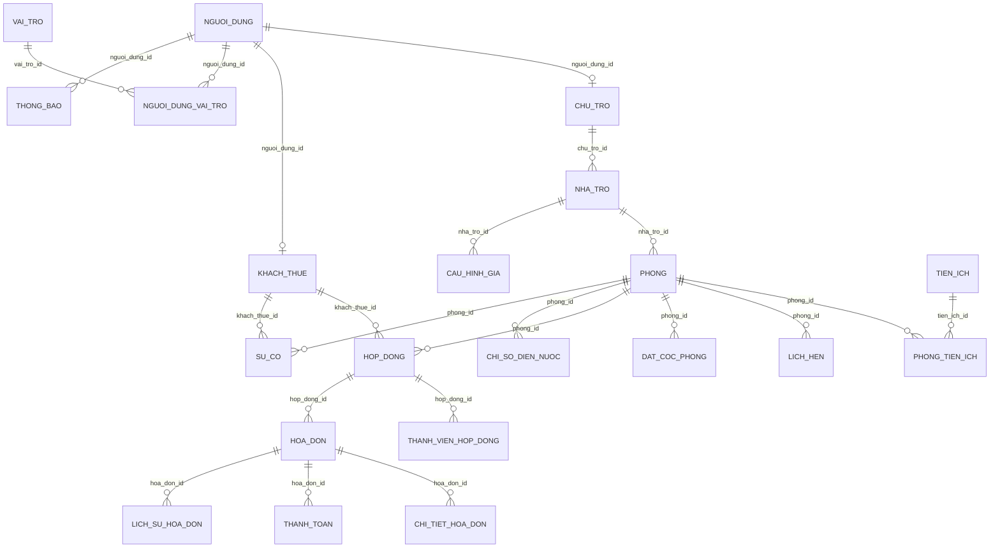

# EasyHouse database review

Nguon: Docker runtime `easyhouse-postgres`, database `easyhouse`, ngay quet 2026-05-19. Runtime hien tai co 22 bang va 31 foreign keys.

## Tong quan schema

Schema da vuot qua CRUD co ban: co user/role, chu tro, nha tro, phong, tien ich, lich hen, dat coc, khach thue, hop dong, thanh vien hop dong, cau hinh gia, chi so dien nuoc, hoa don, thanh toan, su co, thong bao, lich su hoa don.

Van de chinh: schema dang bi lai giua 2-3 lan thiet ke. Mot so bang/cot da co nhung backend/frontend chua dung het; mot so cot bi trung nghia.

## Runtime tables

| Table | Rows | Vai tro |
|---|---:|---|
| `nguoi_dung` | 20 | Tai khoan login/profile |
| `vai_tro` | 3 | Role |
| `nguoi_dung_vai_tro` | 20 | Many-to-many user-role |
| `email_verification_token` | 5 | Token xac thuc email |
| `chu_tro` | 1 | Ho so chu tro/doanh nghiep |
| `nha_tro` | 7 | Toa nha/khu nha tro |
| `phong` | 3 | Phong/unit |
| `tien_ich` | 0 | Danh muc tien ich |
| `phong_tien_ich` | 0 | Many-to-many phong-tien ich |
| `lich_hen` | 0 | Lich xem phong/hen khach |
| `dat_coc_phong` | 0 | Dat coc giu phong |
| `khach_thue` | 6 | Ho so khach thue |
| `hop_dong` | 2 | Hop dong thue |
| `thanh_vien_hop_dong` | 0 | Nguoi o cung trong hop dong |
| `cau_hinh_gia` | 1 | Gia dien/nuoc/dich vu/internet theo nha tro |
| `chi_so_dien_nuoc` | 0 | Chi so dien nuoc theo phong/ngay |
| `hoa_don` | 135 | Hoa don header |
| `chi_tiet_hoa_don` | 9 | Dong hoa don |
| `thanh_toan` | 2 | Giao dich thanh toan |
| `lich_su_hoa_don` | 2 | Audit doi trang thai hoa don |
| `su_co` | 4 | Su co/bao tri |
| `thong_bao` | 122 | Thong bao |

## Quan he chinh

## Table-by-table review

| Table | Dang tot | Can xem lai |
|---|---|---|
| `nguoi_dung` | Co email/phone unique, profile, status, soft delete. | `trang_thai` la varchar trong runtime, nen dung enum/constraint. Can `last_login`, `email_verified_at`, `phone_verified_at`, reset password token rieng. |
| `vai_tro`, `nguoi_dung_vai_tro` | Role many-to-many dung. | Can seed role ro rang: `ADMIN`, `LANDLORD`, `STAFF`, `TENANT`. Frontend dang dung role lowercase/khac nhau. |
| `chu_tro` | Tach landlord profile khoi user, co tax/bank/verified. | Backend/frontend chua co screen. `nha_tro.chu_tro_id` FK bat buoc trong schema dump, can seed chu tro cho admin demo. |
| `nha_tro` | Co owner, address, amenities, soft delete. | Dia chi bi trung: `dia_chi/tinh/huyen/xa` va `so_nha/duong/phuong/quan/thanh_pho`. Can chon 1 chuan. |
| `phong` | Co status, price, deposit, occupancy, images, amenities. | `trang_thai` varchar, enum co ton tai nhung chua dung. Thieu `ma_phong` unique theo nha tro neu khong dung `ten`. |
| `tien_ich`, `phong_tien_ich` | Mo hinh normalized cho amenity. | Frontend/backend hien lai dung `phong.tien_nghi` jsonb. Can chon jsonb hoac bang M-N, khong nen ca hai. |
| `lich_hen` | Co lifecycle appointment. | Chua co backend/frontend CRUD. Nen them source lead, ten khach, phone, note, nguoi_phu_trach. |
| `dat_coc_phong` | Co deposit lifecycle PENDING/COMPLETED/REFUNDED/FORFEITED. | Chua co UI. Can rang buoc phong khong co 2 deposit active. Can bien lai, payment link, expiry. |
| `khach_thue` | Co CCCD, contact, profile, login-ish fields. | Bi trung `anh_cccd` jsonb voi `anh_cccd_truoc/sau`; bi trung `nguoi_dung` voi local `email/mat_khau/ho_ten/so_dien_thoai`. Nen chon user-linked model. |
| `hop_dong` | Co room, tenant, period, rent, deposit status, signatures, PDF, utilities. | Co 3 cach luu nguoi thue: `khach_thue_id`, `khach_thue_ids`, `thanh_vien_hop_dong`. Nen chot: representative + member table. |
| `thanh_vien_hop_dong` | Dung de quan ly nguoi o cung. | Nen FK den `khach_thue` neu nguoi o cung la tenant trong he thong; hoac giu snapshot neu chi khai bao tam tru. |
| `cau_hinh_gia` | Co gia dien/nuoc/dich vu/internet theo nha tro va hieu luc. | Backend invoice hien lay gia tu `hop_dong`, chua dung bang nay. Can quy tac copy gia vao hop dong tai thoi diem ky. |
| `chi_so_dien_nuoc` | Dung de audit chi so theo phong/ngay. | Invoice service hien parse chi so tu `chi_tiet_hoa_don.mo_ta`. Nen doi sang table nay. |
| `hoa_don` | Co header, due date, paid amount, soft delete. Da them `ma_hoa_don`, `ngay_phat_hanh`, `ngay_gui`, `da_gui`, `tien_giam`, `phi_phat_sinh`, enum `OVERDUE`. | Con nhieu dong k6 test co FK null va tong tien 0; can seed/demo data sach hon. |
| `chi_tiet_hoa_don` | Normalized line items, co type, qty, unit price. | `mo_ta` dang bi dung de chua chi so `old-new`; nen them cot metadata jsonb hoac FK chi_so. |
| `thanh_toan` | Co amount, method, reference, status, payer, note. | Thieu `anh_bien_lai`, `provider`, `transaction_id`, `idempotency_key`, `phi_giao_dich`, refund fields. |
| `lich_su_hoa_don` | Co audit trang thai invoice. | Nen mo rong thanh `audit_log` chung cho contract/payment/user critical changes. |
| `su_co` | Co room, tenant, type, priority, assignee, cost, images. | Thieu vendor/nhan vien xu ly, SLA, work order steps, materials, expected/actual completion. |
| `thong_bao` | Co title/body/type/read/target fields. | Bi trung recipient model: `nguoi_dung_id`, `nguoi_gui_id`, `nguoi_nhan` jsonb, `phong`, `phong_ids`, `da_doc`, `da_doc_json`, `nhom_gui_id` khong co FK. Can normalize. |

## Quan he day du runtime

| From | To |
|---|---|
| `cau_hinh_gia.nha_tro_id` | `nha_tro.id` |
| `chi_so_dien_nuoc.phong_id` | `phong.id` |
| `chi_tiet_hoa_don.hoa_don_id` | `hoa_don.id` |
| `chu_tro.nguoi_dung_id` | `nguoi_dung.id` |
| `dat_coc_phong.hop_dong_id` | `hop_dong.id` |
| `dat_coc_phong.nguoi_dung_id` | `nguoi_dung.id` |
| `dat_coc_phong.phong_id` | `phong.id` |
| `email_verification_token.nguoi_dung_id` | `nguoi_dung.id` |
| `hoa_don.hop_dong_id` | `hop_dong.id` |
| `hoa_don.khach_thue_id` | `khach_thue.id` |
| `hoa_don.phong_id` | `phong.id` |
| `hop_dong.khach_thue_id` | `khach_thue.id` |
| `hop_dong.phong_id` | `phong.id` |
| `khach_thue.nguoi_dung_id` | `nguoi_dung.id` |
| `lich_hen.nguoi_dung_id` | `nguoi_dung.id` |
| `lich_hen.phong_id` | `phong.id` |
| `lich_su_hoa_don.hoa_don_id` | `hoa_don.id` |
| `lich_su_hoa_don.nguoi_thay_doi` | `nguoi_dung.id` |
| `nguoi_dung_vai_tro.nguoi_dung_id` | `nguoi_dung.id` |
| `nguoi_dung_vai_tro.vai_tro_id` | `vai_tro.id` |
| `nha_tro.chu_tro_id` | `chu_tro.id` |
| `phong.nha_tro_id` | `nha_tro.id` |
| `phong_tien_ich.phong_id` | `phong.id` |
| `phong_tien_ich.tien_ich_id` | `tien_ich.id` |
| `su_co.khach_thue_id` | `khach_thue.id` |
| `su_co.nguoi_phu_trach` | `nguoi_dung.id` |
| `su_co.phong_id` | `phong.id` |
| `thanh_toan.hoa_don_id` | `hoa_don.id` |
| `thanh_toan.nguoi_thanh_toan` | `nguoi_dung.id` |
| `thanh_vien_hop_dong.hop_dong_id` | `hop_dong.id` |
| `thong_bao.nguoi_dung_id` | `nguoi_dung.id` |

## Uu tien cleanup DB

1. Chot source of truth cho cac cap dang trung:
   - `nha_tro` address flat vs structured.
   - `khach_thue` profile field local vs `nguoi_dung`.
   - `khach_thue.anh_cccd` jsonb vs `anh_cccd_truoc/sau`.
   - `phong.tien_nghi` jsonb vs `phong_tien_ich`.
   - `hop_dong.khach_thue_ids` jsonb vs `thanh_vien_hop_dong`.
   - `thong_bao` recipient/read fields.
2. Dung enum/constraint that su cho status columns, khong de varchar tu do.
3. Them indexes cho tat ca FK, status/date filters, va unique business keys.
4. Them check constraints: amount >= 0, end date >= start date, meter new >= old.
5. Doi invoice logic dung `chi_so_dien_nuoc` va `cau_hinh_gia`, khong parse `mo_ta`.
6. Da them `ma_hoa_don` unique partial cho hoa don; tiep theo them `so_bien_lai`/`ma_giao_dich` unique cho thanh toan.
7. Them audit chung cho thao tac nhay cam: contract, invoice, payment, user role.
