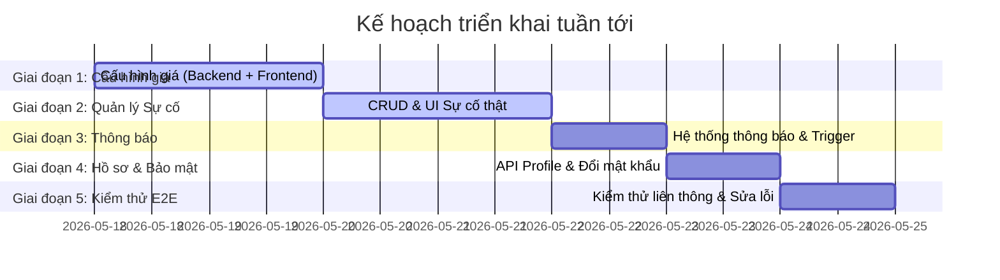

# 📅 KẾ HOẠCH HÀNH ĐỘNG & TRIỂN KHAI CHI TIẾT (WEEKLY PLAN)

> **Dự án**: Quy Lý Phòng Trọ (Rental Management System)  
> **Mục tiêu tuần**: Hoàn thiện 100% các mảnh ghép vận hành còn lại (Cấu hình giá, Sự cố, Thông báo, Hồ sơ) và kiểm thử liên thông (E2E).

---

## 🗺️ LỘ TRÌNH TRIỂN KHAI THEO NGÀY



---

## 📌 CHI TIẾT TỪNG GIAI ĐOẠN

### 1️⃣ GIAI ĐOẠN 1: Cấu hình giá dịch vụ (`cau_hinh_gia`)
*Mục tiêu: Loại bỏ hoàn toàn số cứng (hardcoded), cho phép thiết lập giá dịch vụ chi tiết cho từng tòa nhà.*

#### ◽ Bước 1.1: Database Schema & Entity Mapping
*   **Bảng liên quan:** `cau_hinh_gia` (đã có trong `init_schema.sql`).
*   **Tạo Entity:** `CauHinhGia.java`
    ```java
    @Entity
    @Table(name = "cau_hinh_gia")
    public class CauHinhGia {
        @Id
        @GeneratedValue(strategy = GenerationType.UUID)
        private UUID id;

        @ManyToOne(fetch = FetchType.LAZY)
        @JoinColumn(name = "nha_tro_id", nullable = false)
        private NhaTro nhaTro;

        private BigDecimal giaDien;
        private BigDecimal giaNuoc;
        private BigDecimal giaInternet;
        private BigDecimal giaDichVu; // Phí quản lý/vệ sinh...
        
        private LocalDateTime taoLuc;
        private LocalDateTime capNhatLuc;
    }
    ```

#### ◽ Bước 1.2: Xây dựng Repository & Service
*   **Repository:** `CauHinhGiaRepository.java`
    *   Query lấy cấu hình mới nhất của tòa nhà: 
        ```java
        Optional<CauHinhGia> findFirstByNhaTroIdOrderByTaoLucDesc(UUID nhaTroId);
        ```
*   **Service:** `CauHinhGiaService.java`
    *   `saveCauHinhGia(CauHinhGiaRequest request)`
    *   `getLatestByNhaTro(UUID nhaTroId)`

#### ◽ Bước 1.3: Controller & Frontend Proxy Rewrite
*   **Controller:** `CauHinhGiaController.java` (`/api/cau-hinh-gia`)
*   **Frontend Config:** Thêm config rewrite vào `next.config.ts`:
    ```typescript
    {
        source: '/api/cau-hinh-gia/:path*',
        destination: 'http://localhost:8080/api/cau-hinh-gia/:path*'
    }
    ```

#### ◽ Bước 1.4: Tích hợp vào Luồng Hóa Đơn (`HoaDonService`)
*   Thay vì dùng giá mặc định, khi tạo hóa đơn cho một phòng:
    1. Lấy thông tin phòng -> Lấy `nhaTroId`.
    2. Gọi `CauHinhGiaService.getLatestByNhaTro(nhaTroId)`.
    3. Dùng mức giá này nhân với số điện/nước chênh lệch.

---

### 2️⃣ GIAI ĐOẠN 2: Chuyển đổi Module Sự Cố (`su_co`) thực tế
*Mục tiêu: Kết nối màn hình Sự cố của Khách thuê và Chủ trọ với database thật.*

#### ◽ Bước 2.1: Tạo Entity & Repository Sự cố
*   **Bảng liên quan:** `su_co`.
*   **Tạo Entity:** `SuCo.java`
    *   Trường chính: `id`, `phong` (ManyToOne), `khachThue` (ManyToOne), `tieuDe`, `moTa`, `anhSuCo` (mảng hình ảnh JSONB), `trangThai` (Enum: `PENDING`, `IN_PROGRESS`, `RESOLVED`), `chiPhiSuaChua`, `ngayTao`.

#### ◽ Bước 2.2: Xây dựng CRUD APIs
*   **Khách thuê:** 
    *   `POST /api/su-co` -> Tạo sự cố mới (trạng thái mặc định: `PENDING`).
    *   `GET /api/su-co/my-requests` -> Lấy danh sách sự cố của phòng mình.
*   **Chủ trọ / Admin:**
    *   `GET /api/su-co` -> Lấy tất cả sự cố thuộc các tòa nhà mình quản lý.
    *   `PUT /api/su-co/{id}` -> Chủ trọ tiếp nhận (đổi trạng thái `IN_PROGRESS`), cập nhật chi phí và hoàn thành (`RESOLVED`).

#### ◽ Bước 2.3: Đồng bộ Frontend
*   Kết nối trang Sự cố ở Frontend với API thật.
*   Tích hợp component upload ảnh sự cố lên Cloudinary khi gửi yêu cầu.

---

### 3️⃣ GIAI ĐOẠN 3: Xây dựng hệ thống Thông báo (`thong_bao`)
*Mục tiêu: Đảm bảo luồng tương tác thời gian thực giữa Chủ trọ và Khách thuê.*

#### ◽ Bước 3.1: Entity & Service Thông báo
*   **Bảng liên quan:** `thong_bao`.
*   **Entity:** `ThongBao.java`
    *   Trường chính: `id`, `nguoiNhan` (ManyToOne `NguoiDung`), `tieuDe`, `noiDung`, `loaiThongBao` (Enum: `HOA_DON`, `SU_CO`, `HOP_DONG`, `HE_THONG`), `daDoc` (boolean), `taoLuc`.

#### ◽ Bước 3.2: API Endpoints
*   `GET /api/thong-bao` -> Lấy danh sách thông báo của user đang đăng nhập.
*   `GET /api/thong-bao/unread-count` -> Đếm số lượng thông báo chưa đọc.
*   `PUT /api/thong-bao/{id}/read` -> Đánh dấu đã đọc.

#### ◽ Bước 3.3: Cài đặt Trigger gửi thông báo tự động (Events)
*   **Hóa đơn mới:** Khi chủ trọ chốt hóa đơn thành công -> Hệ thống tự động lưu 1 bản ghi `ThongBao` gửi tới tài khoản `NguoiDung` của khách thuê phòng đó.
*   **Báo sự cố:** Khi khách thuê gửi sự cố thành công -> Tự động tạo thông báo gửi tới Chủ trọ quản lý tòa nhà đó.
*   **Hợp đồng sắp hết hạn:** Viết một tác vụ chạy ngầm định kỳ hàng ngày (Spring `@Scheduled`) quét các hợp đồng còn hạn dưới 30 ngày để tự động gửi thông báo nhắc gia hạn.

---

### 4️⃣ GIAI ĐOẠN 4: Hồ sơ cá nhân & Đổi mật khẩu (`ho-so`)
*Mục tiêu: Bảo mật và cá nhân hóa trải nghiệm người dùng.*

#### ◽ Bước 4.1: Xây dựng Profile APIs tại `UserController.java`
*   `GET /api/user/profile` -> Trả về thông tin cá nhân của User đang đăng nhập dựa trên token JWT.
*   `PUT /api/user/profile` -> Cập nhật thông tin (Số điện thoại, ảnh đại diện, địa chỉ).
*   `PUT /api/user/change-password` -> Đổi mật khẩu bảo mật.

#### ◽ Bước 4.2: Mã hóa mật khẩu an toàn
*   Đảm bảo mật khẩu mới được kiểm tra mật khẩu cũ trùng khớp và được mã hóa bằng `BCryptPasswordEncoder` trước khi lưu vào DB.

---

### 5️⃣ GIAI ĐOẠN 5: Kiểm thử liên thông E2E & Triển khai thử nghiệm
*Mục tiêu: Rà soát lỗi toàn diện trên môi trường Local trước khi đưa lên Staging.*

*   **Kịch bản kiểm thử 1:** Luồng tài chính khép kín:
    1. Tạo `CauHinhGia` cho tòa nhà A.
    2. Tạo hợp đồng cho Khách thuê B tại tòa nhà A.
    3. Nhập số điện mới -> Tạo hóa đơn.
    4. Kiểm tra hóa đơn đã tính tiền điện chuẩn xác theo cấu hình chưa.
*   **Kịch bản kiểm thử 2:** Phân quyền Role-based:
    1. Đăng nhập bằng tài khoản `TENANT` -> Kiểm tra xem có bị lỗi 403 khi cố truy cập `/api/toa-nha` hay không.
    2. Đăng nhập bằng `LANDLORD` -> Kiểm tra xem có xem được dữ liệu của tòa nhà thuộc chủ khác không (đảm bảo tính cô lập dữ liệu).

---

## 🛠️ HƯỚNG DẪN LỆNH CHẠY & KIỂM TRA

### 1. Build & Run Backend
```powershell
cd be
mvn clean install
mvn spring-boot:run
```

### 2. Run Frontend
```powershell
cd frontend
npm run dev
```

### 3. Check Logs CSDL (PostgreSQL)
```sql
-- Kiểm tra xem bảng cấu hình giá đã có dữ liệu chưa
SELECT * FROM cau_hinh_gia ORDER BY tao_luc DESC LIMIT 5;
```

---

> [!IMPORTANT]
> **Quy tắc vàng khi Code:**
> * Không bao giờ sử dụng trực tiếp các đối tượng Entity ở lớp Controller.
> * Luôn bọc toàn bộ logic nghiệp vụ trong `@Transactional` ở lớp Service để tránh mất mát dữ liệu hoặc bất đồng bộ CSDL khi xảy ra lỗi đột ngột.
